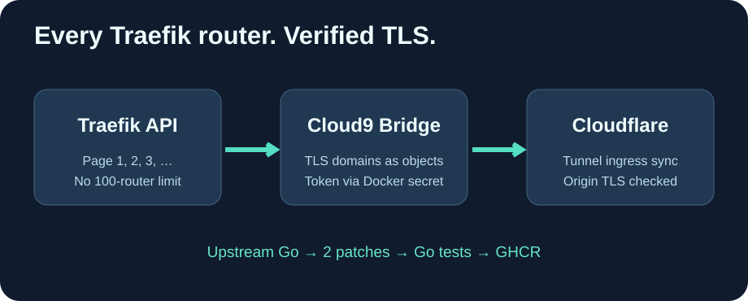

# Cloud9-PangolinTunnel

**Tous les routeurs Traefik, TLS vérifié et image GHCR compilée sur GitHub.**

[English](README.md) · Français · [简体中文](README.zh-CN.md)

Ce dépôt conserve uniquement **deux patchs portables** sur le projet upstream [Pangolin Cloudflare Tunnel](https://github.com/hhftechnology/pangolin-cloudflare-tunnel).

## Fonctionnalités apportées

- Pagination des routeurs Traefik, au-delà de la limite implicite de 100.
- Vérification des certificats TLS d’origine, sans désactivation systématique de la vérification.
- Domaines Traefik v3 avec objets main / sans.
- Chargement du jeton Cloudflare par secret Docker avec CLOUDFLARE_API_TOKEN_FILE.
- Compilation Go 1.27, utilisateur non privilégié, image minimale et certificats CA.

La CI GitHub récupère le **dernier upstream main**, applique les deux patchs, lance les tests Go et construit une image GHCR candidate. Un patch devenu incompatible bloque la publication plutôt que de faire disparaître une fonction.

**Un tunnel en production ne doit pas être remplacé sans vérification** des DNS, routes, ingress et TLS. Après certification, un simple pull Docker suffit : pas de compilation sur le serveur.

Aucun jeton, domaine personnel ou chemin interne n’est publié. Les patchs suivent la licence MIT et conservent l’attribution originale.
