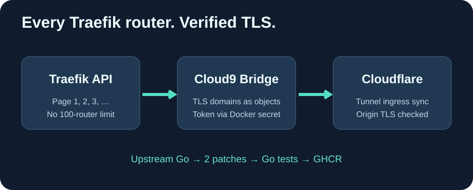

<h1 align="center">Cloud9-PangolinTunnel</h1>

<strong>Keep every Traefik route. Verify origin TLS. Update on GitHub, not your server.</strong>

English · <a href="README.fr.md">Français</a> · <a href="README.zh-CN.md">简体中文</a>

Cloud9-PangolinTunnel maintains **two portable patches** against the original [hhftechnology/pangolin-cloudflare-tunnel](https://github.com/hhftechnology/pangolin-cloudflare-tunnel). Not affiliated with Cloudflare or the upstream developers.

## Improvements beyond upstream

- **Complete Traefik route discovery**: fetch HTTP routers in batches of 100, including pages beyond the first.
- **Verified origin TLS**: disable the insecure upstream default that skips Cloudflare origin certificate validation.
- **Traefik v3 domains**: correctly parse TLS domain objects with main and SANs fields.
- **Docker secrets**: support CLOUDFLARE_API_TOKEN_FILE as well as conventional CLOUDFLARE_API_TOKEN.
- **Lean and maintained runtime**: Go 1.27, rootless UID 65532, a scratch image with trusted CA bundle.

## CI and prebuilt images

On every commit, nightly schedule and manual dispatch, GitHub Actions clones the current official upstream main, checks and applies the two patches, runs Go tests, builds an image and pushes a provenance-labeled **candidate** to ghcr.io/godsquantum/cloud9-pangolin-tunnel.

If upstream merges a fix or changes a patch target, CI deliberately fails instead of silently losing the feature. **A live production tunnel is never redeployed by this workflow**. Before promoting a tested candidate, validate DNS, Traefik routing, Cloudflare ingress and origin certificates with a rollback image.

The GitHub Action run prints the exact image tag. A mutable latest tag is withheld until operational equivalence has been validated. The production host should only pull a published image and never run Go compilation during regular updates.

## Privacy and configuration

Keep API tokens, zone IDs, tunnel IDs, hostnames, IP addresses and Compose configuration outside this public repository. Use a secret file or your own environment file; do not commit credentials. Build and test steps do not contact your Cloudflare account.

Our patch set and packaging are MIT-licensed; the upstream README also states MIT licensing, and upstream attribution remains intact.
