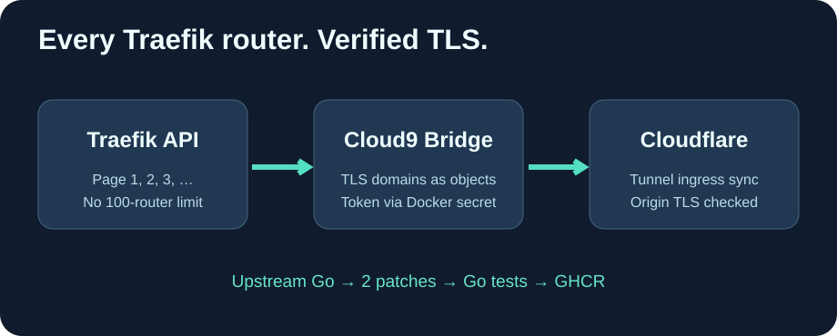

# Cloud9-PangolinTunnel

**完整的 Traefik 路由同步、经过验证的源站 TLS，以及 GitHub 预构建的 GHCR 镜像。**

[English](README.md) · [Français](README.fr.md) · 简体中文

本项目仅对上游 [Pangolin Cloudflare Tunnel](https://github.com/hhftechnology/pangolin-cloudflare-tunnel) 维护**两个通用补丁**，不重写原始 Go 应用。

## 改进

- 分页获取全部 Traefik 路由，不再丢失前 100 条以外的路由。
- 默认验证源站 TLS 证书，避免跳过证书验证。
- 按 Traefik v3 的 main 与 SANs 对象格式读取 TLS 域名。
- 通过 CLOUDFLARE_API_TOKEN_FILE 从 Docker Secret 安全读取密钥。
- 使用 Go 1.27、CA 根证书和非特权用户构建轻量级镜像。

GitHub Actions 每天检查上游主分支，应用补丁、执行 Go 测试并构建**不可变候选镜像**。若补丁不再适用，构建失败以防止功能回退。

**不要仅凭新镜像就自动替换生产环境隧道。** 必须先验证 DNS、路由、TLS 和回滚路径。验证完成后生产服务器只需拉取镜像，无须编译 Go。

公开仓库不包含个人域名、服务器地址或 Cloudflare 密钥。补丁遵循 MIT 许可证并保留上游作者署名。
